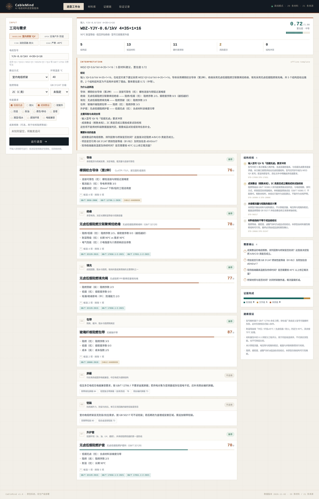
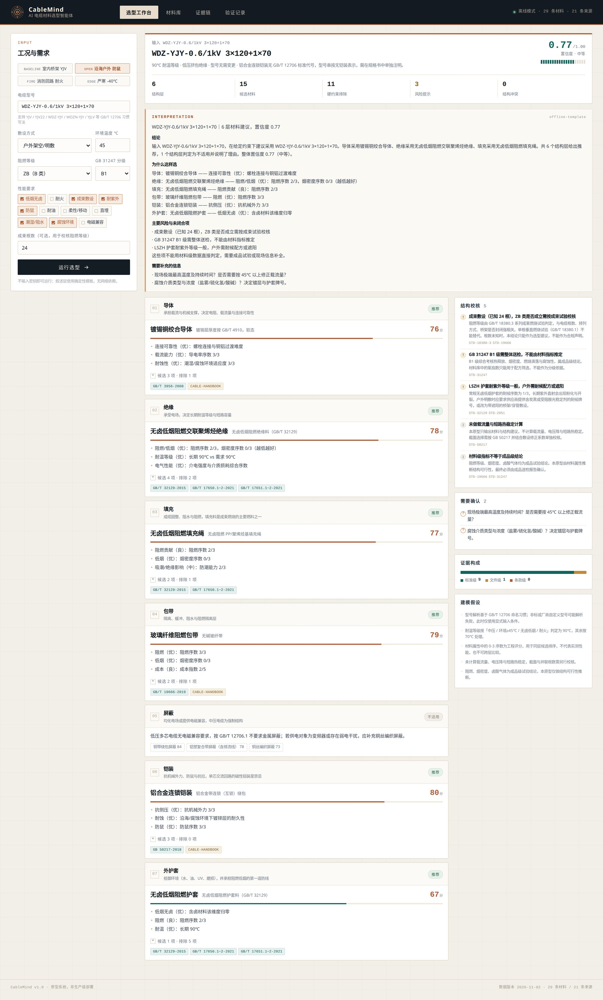

# CableMind · AI 电缆材料选型智能体

给定电缆型号与工况，输出**导体 / 绝缘 / 填充 / 包带 / 屏蔽 / 铠装 / 外护套**七层的候选材料、推荐项、取舍理由、适用边界与可追溯证据。

不是"让大模型写一段选型建议"，而是：**规则做合规过滤 → 打分做工程排序 → 材料库固定绑定证据 → 大模型只负责复述**。



---

## 快速启动

```bash
git clone <repo-url> && cd ai-cable-material-agent
pip install -r requirements.txt
uvicorn app.main:app --reload --port 8000
# 打开 http://127.0.0.1:8000
```

**不需要任何密钥。** 未配置 `LLM_API_KEY` 时，叙述层走确定性模板（`offline-template`），完整链路照常运行。这是刻意的降级设计，避免评审环境因无 API Key 而看不到结果。

可选的大模型叙述层：

```bash
cp .env.example .env    # 填入 LLM_API_KEY / LLM_BASE_URL / LLM_MODEL
```

任何调用异常都会自动回退到离线模板，并在返回体的 `narrative.mode` 中标注 `fallback`。

---

## 三个演示案例

| 案例 | 输入 | 关键输出 |
|---|---|---|
| **基准** | `YJV-0.6/1kV 4×35+1×16`，室内桥架，40℃，成束，阻燃+低烟 | 识别出 **YJV 的 PVC 护套与低烟要求冲突**，建议升级为 `WDZ-YJY`；铜导体、LSZH 绝缘/填充/护套、玻纤阻燃包带；屏蔽与铠装判为不适用并给出理由；置信度 0.72 |
| **开放场景** | `WDZ-YJY-0.6/1kV 3×120+1×70`，沿海户外，45℃，ZB，B1，盐雾+鼠害+UV | 镀锡铜导体；**铠装从钢带切换为铝合金连锁**（耐蚀权重压过成本）；LSZH 护套触发紫外警告；B1 级提示必须整体送检 |
| **边界（已知缺陷）** | `WDZ-YJY-0.6/1kV 3×70+1×35`，-40℃ 户外直埋 | 仍推荐常规 LSZH 护套，只给出一条警告——**这是失败的**，原因与改进方向见验证记录 T-05 |



---

## 技术架构

```
┌──────────────────────────── 浏览器（原生 JS，无构建） ────────────────────────────┐
│  表单  ·  结果层卡片  ·  候选/排除明细  ·  证据抽屉  ·  验证记录                    │
└───────────────────────────────────┬───────────────────────────────────────────────┘
                                    │ POST /api/select
┌───────────────────────────────────▼───────────────────────────────────────────────┐
│ FastAPI                                                                           │
│  ┌─────────────┐   ┌──────────────┐   ┌──────────────┐   ┌─────────────────────┐  │
│  │ 型号解析器   │ → │ 需求推导      │ → │ 七层选型引擎  │ → │ 证据装配 + 置信度    │  │
│  │ parse_model │   │ derive_needs │   │ 过滤→打分→耦合│   │ citations/checks    │  │
│  └─────────────┘   └──────────────┘   └──────┬───────┘   └──────────┬──────────┘  │
│                                              │                      │             │
│                    ┌─────────────────────────▼──────┐   ┌───────────▼──────────┐  │
│                    │ materials.json (29 条材料)      │   │ llm.py 叙述层         │  │
│                    │ standards.json (21 条来源)      │   │ 有 Key→LLM，无 Key→模板│  │
│                    └────────────────────────────────┘   └──────────────────────┘  │
└───────────────────────────────────────────────────────────────────────────────────┘
```

### 为什么不用向量 RAG

材料库是只有 29 条记录的**封闭集合**，每条记录都有明确的 `category` 与 `attrs`。此时向量检索的召回误差（把中压条款召回到低压、把"推荐"召回到"强制"）是纯负收益；结构化过滤 + 精确引用绑定才是更可靠的做法。

真正需要"检索"的是标准条文，而条文检索在当前规模下无法做到条款级可信定位（见"已知限制"），因此本项目**不假装做了 RAG**，而是把引用精确度如实标注为"标准级"。

### 选型流程（engine.py）

1. **解析**：从型号串提取绝缘代号、导体（L=铝）、护套、铠装代号、电压、芯数×截面，并保留解析告警。
2. **推导需求**：中压/低压、耐温等级（70/90℃）、是否需屏蔽、是否需铠装、是否低烟无卤、低温下限。
3. **硬约束过滤**：合规与安全先于评分。例如：
   - 单芯交流回路 × 钢带/钢丝铠装 → 直接排除（GB 50217，涡流与感应电压）
   - 低烟无卤 × PVC/PE/无纺布/PP 填充 → 直接排除
   - 6kV 以上 × PVC 绝缘 → 直接排除
   - 中压 × 铝塑复合带屏蔽 → 直接排除（不能承担短路电流）
4. **加权打分**：每个候选按层内准则（耐温裕度、阻燃低烟、耐蚀、成本、柔性…）计算 0-100 分，权重随需求变化（如腐蚀环境下"耐蚀"权重从 0.04 提升至 0.26）。
5. **层间耦合检查**：型号与需求冲突、成束根数缺失、B1 级不能由材料推定、直埋无铠装、LSZH 低温下限。
6. **置信度**：按 error/warn/缺失信息逐项扣减，范围 0.30–0.95。
7. **证据装配**：每条推荐的材料记录 → `sources` → 标准/文献记录，去重后按"使用层"聚合。

---

## 目录结构

```
app/
  engine.py      选型引擎：解析、过滤、打分、耦合检查、置信度（核心，约 700 行）
  llm.py         叙述层：LLM 调用 + 离线模板 + 异常回退
  models.py      Pydantic 请求/响应模型
  main.py        FastAPI 路由与静态资源
data/
  materials.json 29 条材料记录（7 个类别，含物理性能、限制、来源、更新时间）
  standards.json 21 条来源（18 条国家/行业标准 + 3 条厂商/教材文件）
  scenarios.json 4 个演示场景（含 1 个已知缺陷场景）
  validation.json 5 条验证记录
web/             index.html / styles.css / app.js（原生实现，无构建步骤）
tests/           20 个测试：引擎约束、引用完整性、API 冒烟、确定性
docs/
  DESIGN.md      设计说明（为什么这样选型、如何降低幻觉）
  VALIDATION.md  验证记录（5 条，含 1 条失败）
screenshots/     运行截图
```

---

## API

| 方法 | 路径 | 说明 |
|---|---|---|
| `POST` | `/api/select` | 入参见 `app/models.py::SelectionRequest`，返回七层结果 + 校核 + 引用 + 叙述 |
| `GET` | `/api/materials` | 材料数据集 |
| `GET` | `/api/standards` | 来源清单 |
| `GET` | `/api/scenarios` | 预置场景 |
| `GET` | `/api/validation` | 验证记录 |
| `GET` | `/api/health` | 健康检查（返回材料/来源条数） |

```bash
curl -s -X POST http://127.0.0.1:8000/api/select \
  -H 'Content-Type: application/json' \
  -d '{"model":"YJV-0.6/1kV 4×35+1×16","lszh":true,"flame":"ZC","bundle":true}' | python -m json.tool
```

---

## 怎么判断这个原型靠不靠谱

1. **看排除项**：每个"排除"都带硬约束理由与引用。如果只有推荐没有排除，说明引擎没在做约束。
2. **看型号冲突**：输入 `YJV` 却要求低烟无卤，引擎必须报冲突而不是静默替换。
3. **看单芯中压**：`YJV22-26/35kV 1×300` 必须报 error 并改非磁性铠装。这是"硬约束优先于打分"的关键验证。
4. **看失败案例**：T-05 是真实失败，不是摆设。

```bash
python -m pytest -q     # 20 passed
```

---

## 已知限制（必须读）

| 限制 | 影响 | 改进方向 |
|---|---|---|
| **引用只到"标准 + 要求项"，没有条款号/页码** | 无法直接作为合规声明 | 接入标准全文库做条款级锚定；当前如实标注 `precision: standard` |
| **材料粒度到"类别"，不到"牌号"** | -40℃ 场景推荐了常规 LSZH（T-05 失败根因） | 护套按牌号细分（常规 -25℃ / 耐寒 -40℃），并支持无候选时拒答 |
| **不计算载流量、电压降、短路热稳定** | 截面与并联根数需另行校核 | 接入 GB 50217 载流量表与敷设修正系数 |
| **阻燃/烟密度/卤酸为成品级结论** | 材料属性只能推断结构可行性 | 增加成品送检数据字段，或接入检测报告 |
| **未做中压金属护套感应电压与环流计算** | 单芯中压铠装/接地方案不完整 | 补充短路电动力与护套感应电压模块 |
| **LLM 只做复述，未做工具调用** | 复杂追问能力有限 | 可加 function calling 查询材料库，但需保留引用校验 |

这些限制在 `docs/DESIGN.md` 中有对应说明，原型中的简化假设也全部输出在结果页的"建模假设"区。

---

## 数据与来源

- 18 条国家/行业标准：GB/T 12706.1/.2、GB/T 3956、GB/T 19666、GB 31247、GB/T 18380 系列、GB/T 17650、GB/T 17651、GB/T 19216、GB 50217、GB/T 2951、GB/T 32129、GB/T 8815、GB/T 5013、GB/T 5023、GB 50016
- 3 条厂商/教材文件：Borealis Borlink、Dow Endurance、国内主流电缆厂公开样本与《电线电缆手册》

**引用诚实性说明**：标准条文以标准正文为准，本原型记录到"标准号 + 要求项"粒度，未虚构条款号与页码。厂商样本仅作工程参考，不替代标准。

---

## 成本与密钥

- 运行成本：0（离线模式无外部调用）
- 可选 LLM：按 token 计费，单次选型约 1.5k input / 500 output token
- 仓库内不含任何真实密钥，`.env` 已在 `.gitignore` 中

---

## License

仅用于候选人技术评估，未经授权不得商用。
